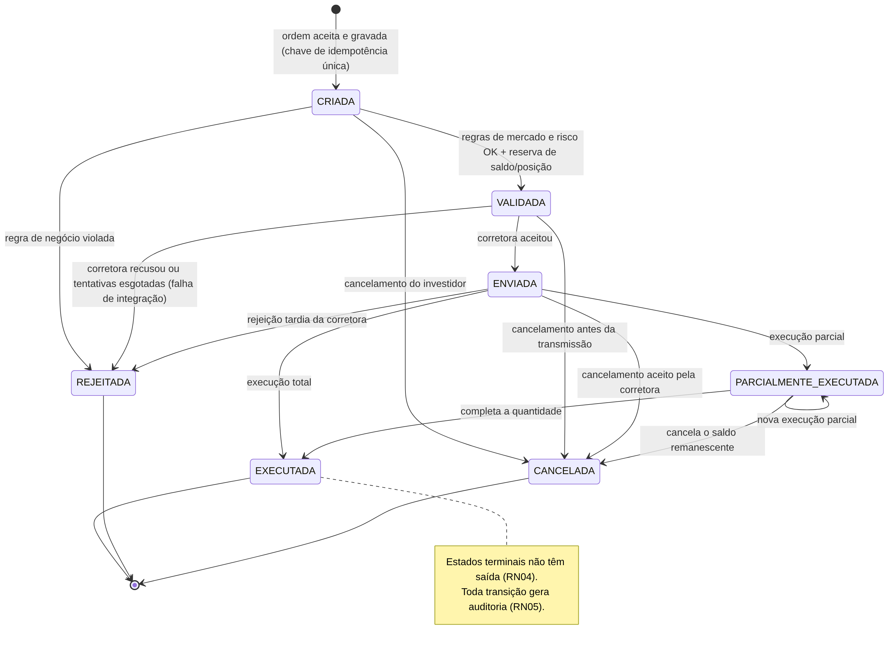
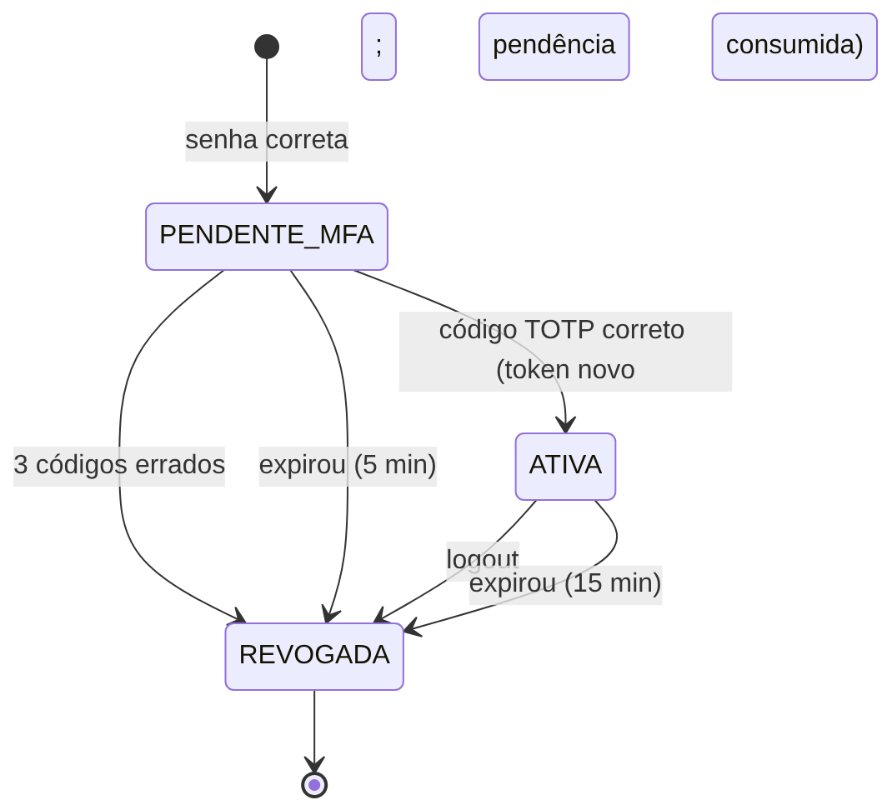
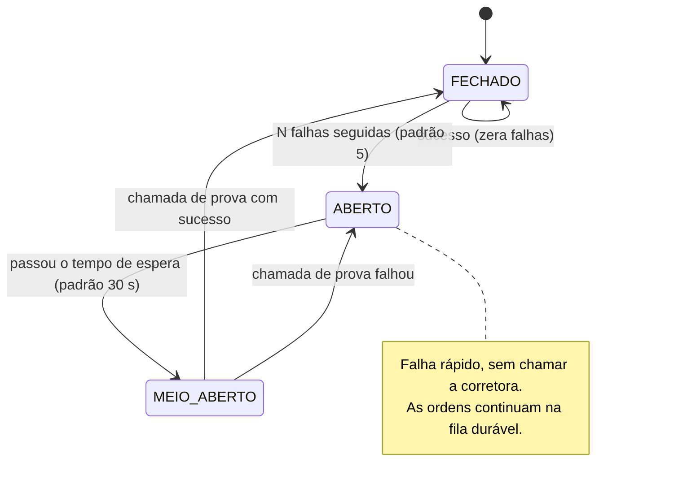

# UML — Diagramas de estados

## 1. Ordem (RF09, RN04)
Os três estados finais (**EXECUTADA, REJEITADA, CANCELADA**) não têm transição de saída: uma ordem nunca "volta" (RN04).
`PARCIALMENTE_EXECUTADA` pode repetir-se a cada nova execução. A tabela está codificada em `StatusOrdem` e testada em `StatusOrdemTest`.

Fonte: [`ordem.mmd`](ordem.mmd)

| Estado | Reserva mantida? | Significado |
|---|---|---|
| CRIADA | não | Gravada (com chave única), ainda sem validações de risco/reserva. |
| VALIDADA | **sim** | Regras OK e saldo/posição reservados; na fila para a corretora. |
| ENVIADA | **sim** | A corretora aceitou. |
| PARCIALMENTE_EXECUTADA | **sim** (do restante) | Parte da quantidade foi executada e liquidada. |
| EXECUTADA / REJEITADA / CANCELADA | não | Estados terminais. |

## 2. Sessão (RF01, RF02)

Fonte: [`sessao.mmd`](sessao.mmd)

## 3. Circuit breaker da corretora (RF16, RNF04)

Fonte: [`circuit-breaker.mmd`](circuit-breaker.mmd)
